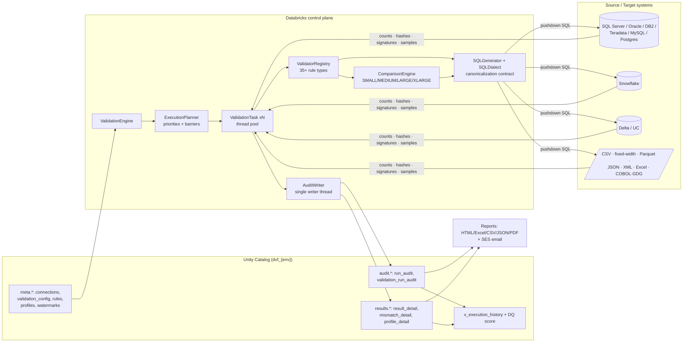
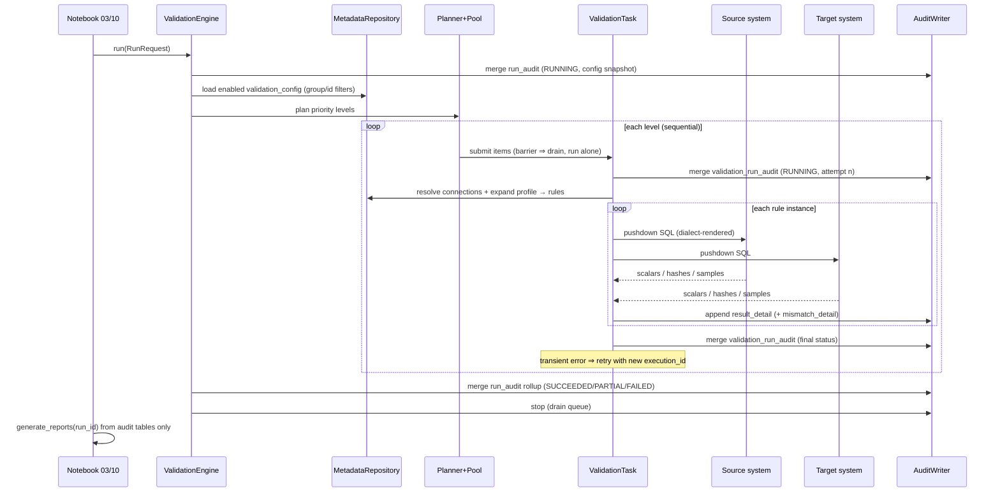

# DVF Architecture

## 1. Layer model

| Layer | Realization |
|---|---|
| Presentation | HTML/Excel/CSV/JSON/PDF reports, email, dashboard notebook + `v_execution_history` |
| Execution | `ValidationEngine` → `ExecutionPlanner` (priority levels, barriers) → thread pool → `ValidationTask` |
| Validation | `ValidatorRegistry` + 35+ `BaseValidator` classes (rule types) |
| Comparison | `ComparisonEngine` tiers + `DrillDownComparator` + `differ` |
| SQL Generation | `SQLGenerator` (Jinja2 statement shapes) + `SQLDialect` (atomic expressions, canonicalization) |
| Connector | `BaseConnector` ABC → JDBC family / Snowflake / Delta / files / sqlite |
| Metadata | Delta tables in Unity Catalog via `StorageBackend` (`DeltaBackend` prod, `SqliteBackend` test) |
| Configuration | pydantic `FrameworkSettings` ← framework.yaml ← env overlay ← `DVF__*` env vars |
| Audit | `AuditWriter` (single background writer, micro-batched) + structured `AuditLogger` (correlation IDs) |
| Exception | `results.mismatch_detail` (missing/extra/column diffs with keys, row payloads, bucket lineage) |
| Security | `SecretResolver`: Databricks secret scopes / AWS Secrets Manager / env (local) — credentials never persisted |
| Storage | S3 report artifacts; all framework state in Delta |

## 2. Component diagram



## 3. Run lifecycle (sequence)



## 4. MEDIUM tier — row-hash comparison

```mermaid
sequenceDiagram
    participant CE as ComparisonEngine
    participant SRC as Source engine
    participant TGT as Target engine
    participant D as Differ (driver or Spark)

    CE->>SRC: SELECT canon(keys), md5(canonical row) — pushdown
    CE->>TGT: SELECT canon(keys), md5(canonical row) — pushdown
    Note over SRC,TGT: no-hash engines return the canonical string;<br/>client/Spark hashes it (identical result)
    SRC-->>D: (key, hash) set
    TGT-->>D: (key, hash) set
    D->>D: full outer join on canonical keys
    D-->>CE: counts + sampled keys (missing / extra / mismatched)
    CE->>SRC: fetch full canonical rows WHERE key IN (samples)
    CE->>TGT: fetch full canonical rows WHERE key IN (samples)
    CE->>CE: column-by-column diff → mismatch_detail rows
```

## 5. XLARGE tier — recursive drill-down

Per level, per side, ONE aggregate query:

```sql
SELECT MOD(FLOOR(key_hash / N^depth), N) AS bucket_id,
       COUNT(*)                          AS cnt,
       SUM(hex_slice(row_md5, 1, 8))     AS sig1,   -- two independent
       SUM(hex_slice(row_md5, 9, 8))     AS sig2    -- 8-hex-char slices
FROM   object WHERE <parent bucket predicates>
GROUP  BY 1
```

```
compare(pred, depth):
    S, T = signatures(source, pred, depth), signatures(target, pred, depth)
    for each bucket where (cnt, sig1, sig2) differ:
        child = pred AND bucket_expr(depth) = b
        if max(cnt) <= leaf_threshold or depth >= max_depth:
            row_hash_compare(child)          # MEDIUM scoped to the bucket
        else:
            compare(child, depth + 1)        # independent digit per level
```

* Equal buckets are **proven equal** without moving a row.
* `bucket_path` ("17/3/9") is recorded on every emitted mismatch.
* Key bucketing: numeric key → `MOD(ABS(key), N)`; else md5(key)-derived int.
* **No-hash engines** (DB2, Teradata): signature slices are replaced by typed
  aggregate signatures (COUNT + SUM numerics + SUM(LENGTH) strings + null-aware
  boolean sums); leaves fetch canonical strings and hash client-side.

## 6. Canonicalization contract (cross-engine correctness core)

Every dialect renders each column to a byte-identical canonical string:

| Category | Canonical form |
|---|---|
| delimiter / NULL | `\|~\|` between columns; `COALESCE(x, '<NULL>')` |
| STRING | `RTRIM(x)` always (CHAR padding); `UPPER(...)` when case_insensitive |
| INTEGER & DECIMAL(p,0) | plain digits (`123`) |
| DECIMAL / FLOAT | fixed scale (default 6), zero-padded: `123.500000` |
| DATE | `YYYY-MM-DD` |
| TIMESTAMP | `YYYY-MM-DD HH:MI:SS.FFFFFF` (precision configurable per validation — DB2 TIMESTAMP(6) vs SQL Server DATETIME) |
| BOOLEAN | `1` / `0` |
| BINARY | lowercase hex |
| hash | lowercase-hex MD5 (`LOWER()`-wrapped on engines returning uppercase) |

Decimal scale is **unified per column pair** before SQL generation
(`comparison/plan.py`), so `DECIMAL(18,2)` vs `DECIMAL(18,4)` still hash
identically. Golden tests pin every dialect's rendering byte-exactly.

## 7. Execution & audit invariants

* Checkpoint grain = **validation attempt** (`execution_id`); resume skips
  PASSED, rerun-failed selects latest-attempt failures.
* All Delta writes funnel through **one** background writer thread
  (micro-batch 5s/500 rows) — no concurrent MERGE conflicts, tasks never block.
* Retry only on **transient** classification (SQLSTATE/vendor-code driven);
  data mismatches never retry.
* Reports read **only** audit/result tables — any run re-renders byte-stable.
* Correlation ID `run_id:validation_id:execution_id` on every log line.

## 8. Extensibility

| Add… | Do… | Engine changes |
|---|---|---|
| a system | implement `BaseConnector` (+ `SQLDialect` if a new SQL flavor), `register_connector()` / `register_dialect()` | none |
| a validation type | subclass `BaseValidator`, `@ValidatorRegistry.register("MY_TYPE")` | none |
| a profile | insert rows into `meta.validation_profiles` | none |
| a report format | subclass `ReportGenerator`, `register_report_format()` | none |
